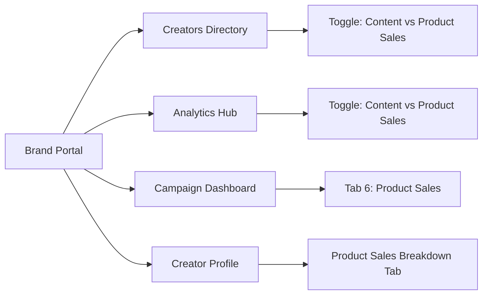

# PRD: Product-Level Sales Attribution & Analytics (Orders Model)

| Document Details | |
| :--- | :--- |
| **Feature Name** | Product Sales Tracking & Attribution |
| **Product** | HaulPack Brand Portal |
| **Status** | Active / Implemented |
| **Target Audience** | Brand Managers, Influencer Marketing Teams, Operations |

---

## 1. Problem Statement

Today, brands partner with creators across multiple campaigns, reels, and product hauls. However:
* Brands can see aggregate collection revenue or video views, but cannot easily answer:
  > **“How many actual orders of Product X did Creator Y generate for us?”**
* If a creator adds the same product into 3 different reels and 2 collections, attribution gets fragmented across links rather than showing the creator's true cumulative order impact on that specific product.
* Brands need item-level clarity to decide which creators to re-hire for specific product launches.

---

## 2. Product Objective

Provide brands with a **direct, product-level sales breakdown** that attributes actual orders and sales revenue back to individual creators and campaigns—independent of video views or collection groupings.

### Key Goals:
1. **Direct SKU Attribution**: Attribute sales directly to `Product → Creator → Campaign`.
2. **Unified Aggregation**: Automatically combine orders of a product even if a creator featured it in multiple posts or collections.
3. **Simplicity & Alignment**: Standardize on **Orders** and **Sales Value** matching HaulPack's native affiliate tracking model.

---

## 3. How It Works (Business Logic)

### A. The "Product First" Attribution Rule
* Even if Creator A adds **Head & Shoulders Shampoo** to:
  * 1 Instagram Reel
  * 2 HaulPack Collections
  * 1 YouTube Description Link
* The analytics automatically rolls up all purchases into **one clean row**:
  $$\text{Head \& Shoulders} \longrightarrow \text{Creator A} \longrightarrow 32\text{ Orders} \longrightarrow ₹16,000$$

### B. Standardized Orders Model
* In HaulPack, **each purchase through a creator's product link is counted as an Order**.
* The UI displays **"Orders"** and **"Sales Value"** as the core conversion metrics, removing cluttered duplicate columns.

### C. Campaign Boundaries
* If a product is featured across both a **Summer Launch** and a **Festive Collab**, orders are kept separate per campaign so brands can evaluate each campaign's individual ROI.

---

## 4. User Experience & Screen Overview

---

### Screen 1: Creators Directory (`/creators`)
* **What the Brand Sees**: A toggle button in the toolbar: **[Content]** vs **[Product Sales]**.
* **When "Product Sales" is Selected**:
  * The table displays:
    * **Orders**: Total purchase orders this creator drove.
    * **Sales Value**: Total revenue generated (`₹`).
    * **Products**: How many unique products they successfully sold.
    * **Analytics Link**: Direct button to view their profile.

---

### Screen 2: Performance Analytics (`/analytics`)
* **What the Brand Sees**: A high-level switch at the top between **Content Performance** and **Product Sales**.
* **Product Sales Overview (KPI Cards)**:
  1. **Total Orders**: Total purchase orders across all tracked products.
  2. **Total Product Sales Value**: Total GMV generated (`₹`).
  3. **Active Creators**: Number of creators with at least 1 tracked order.
  4. **Active Products**: Number of catalog products with recorded orders.
* **Catalog Sales Table**:
  * Ranked leaderboard of products showing which creator drove the sales, their social platform, total orders, and gross sales value.

---

### Screen 3: Campaign Dashboard (`/campaigns/:id`)
* **What the Brand Sees**: A dedicated **"6. Product Sales"** tab in the campaign navigation.
* **Purpose**:
  * Shows campaign-specific orders and revenue per creator without data blending into other campaigns.

---

### Screen 4: Creator Profile (`/creators/:id`)
* **What the Brand Sees**: A **Product Sales** tab inside the creator's individual profile.
* **Purpose**:
  * Displays itemized orders and revenue for every product that creator has recommended.

---

## 5. Metrics Glossary

| Metric | Definition | Example |
| :--- | :--- | :--- |
| **Orders** | Total purchase orders completed for the product through the creator's tracked links. | `24` orders |
| **Sales Value** | Gross monetary value of the orders (`Orders × Retail Price`). | `₹12,000` |
| **Active Creators** | Count of distinct creators who generated at least 1 product order. | `18` creators |
| **Active Products** | Count of distinct catalog items that have recorded orders. | `5` products |

---

## 6. Success Metrics for this Feature

* **Faster Brand Reporting**: Brands can identify top-selling creators per SKU in seconds.
* **Re-engagement Rate**: Increase in repeat campaign bookings for creators with proven product orders.
* **Data Clarity**: Clean terminology matching HaulPack's platform standards.
